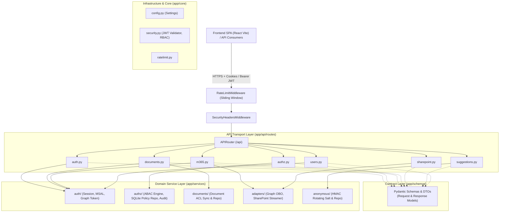

# Center of Excellence (CoE) Platform Backend

An enterprise-grade, high-performance FastAPI service engineered for the ELAN Center of Excellence (CoE). The platform delivers Microsoft Entra ID authentication, a 5-layer Authorization Engine (ABAC/ReBAC/RBAC), Zero-Trust Microsoft Graph & SharePoint OBO delegation, document streaming and Office Online editing, and privacy-preserving unattributed employee feedback.

---

## Table of Contents
1. [Core Features](#core-features)
2. [Architectural Principles](#architectural-principles)
3. [System Architecture](#system-architecture)
4. [Core Architectural Pillars](#core-architectural-pillars)
5. [Directory Layout](#directory-layout)
6. [API Surface Directory (19 Endpoints)](#api-surface-directory)
7. [Persistence & Data Architecture](#persistence--data-architecture)
8. [Configuration Reference](#configuration-reference)
9. [Development & Testing Guide](#development--testing-guide)

---

## Core Features

* **Microsoft Entra ID Authentication**: Single confidential app registration (`COE-Platform`), OIDC auth code flow with PKCE, server-side encrypted Redis sessions, sliding idle timeouts, front-channel single logout.
* **5-Layer Authorization Engine (PDP)**: Default-deny ABAC, ReBAC, RBAC with dynamic entitlement computation and non-repudiation audit logging.
* **Zero-Trust SharePoint & M365 Integration**: Native non-buffering document streaming via user OBO delegation, direct Office Online edit links, and delegated Outlook/Teams/Calendar panels.
* **Privacy-Preserving Suggestion Box**: Authenticated, unattributed employee feedback using daily rotating HMAC salts.

---

## Architectural Principles

1. **Clean 4-Tier Layering**: Strict unidirectional dependency flow:
   $$\text{Transport (API)} \longrightarrow \text{Contracts (Schemas)} \longrightarrow \text{Domain (Services)} \longrightarrow \text{Foundation (Core)}$$
2. **Zero-Trust Delegation**: Never act as an omnipotent service principal when acting on user data. Always use user-delegated tokens (OBO) to respect underlying Microsoft 365 ACLs.
3. **Fail-Closed Security**: If external identity sources (e.g., Microsoft Graph snapshot) are unavailable or throttled, access is denied (HTTP 503) rather than defaulted to permissive roles.
4. **Defense in Depth**: Every request is guarded by sliding-window rate limiters, strict CORS allow-lists, origin verification, CSRF double-submit cookies, and security response headers.
5. **Root Directory Integrity**: `app/main.py` is the **only Python module** directly at the `/app` root level. All packages utilize clean, empty `__init__.py` markers.

---

## System Architecture



---

## Core Architectural Pillars

### Pillar 1: Dual Authentication & BFF Session Lifecycle
1. **Cookie-Based Web Session (BFF Architecture)**:
   - Web browsers never store raw access tokens in `localStorage` or `sessionStorage`.
   - The platform mints an `elan_session` HttpOnly, SameSite=Lax cookie containing an encrypted session identifier.
   - Session data is encrypted at rest in Redis using AES-256 (Fernet) keys.
2. **Bearer Token Authentication**:
   - Accepts standard OAuth 2.0 Bearer JWTs emitted by Microsoft Entra ID.
   - Enforces strict token validation: audience match (`CLIENT_ID` or `api://{CLIENT_ID}`), tenant isolation, token expiry (`exp`), and certificate signatures via Microsoft JWKS (`jwks_uri`).
3. **CSRF Protection**:
   - Double-submit CSRF cookie (`elan_csrf`) is verified on all state-changing HTTP methods (`POST`, `PUT`, `PATCH`, `DELETE`).

### Pillar 2: 5-Layer Authorization & Entitlements Engine (PDP)
1. **Default-Deny Policy**: A request is denied unless an explicit rule allows it.
2. **Dynamic ABAC & ReBAC Evaluation**: Evaluates caller roles, Entra ID security groups, organizational attributes, and resource relationships.
3. **Fast-Path Policy Decision Cache**: Rules and group memberships are cached with sliding TTLs to maintain sub-millisecond evaluation latency.

### Pillar 3: Zero-Trust SharePoint & Microsoft 365 OBO Integration
1. **On-Behalf-Of (OBO) Delegation**:
   - Exchanges the signed-in user's Bearer token for a downstream Graph token using MSAL confidential client credentials (`CLIENT_ID` + client certificate).
   - Scoped strictly to needed permissions (`https://graph.microsoft.com/User.Read`, `Files.Read`, `Files.ReadWrite`).
2. **Native File Streaming without Memory Buffering** (`/api/sharepoint/files/{item_id}/stream`):
   - Employs `httpx.AsyncClient` with `resp.aiter_bytes()` streaming chunks directly to the FastAPI `StreamingResponse`.
   - Prevents memory spikes on large file transfers (e.g. 100MB+ PDFs or video presentations).
3. **Office Online Direct Edit Links** (`/api/sharepoint/files/{item_id}/edit-link`):
   - Obtains authenticated web URLs to edit documents directly in Office Online (Word, Excel, PowerPoint).

### Pillar 4: Privacy-Preserving Anonymous Suggestion Box
1. **Complete Identity Stripping**:
   - Discards `oid`, `email`, IP address, and `User-Agent`.
   - Database schema stores strictly: `id`, `submission_date`, `category`, and `suggestion_text`.
2. **Distributed Rotating Salt Spam Protection**:
   - Computes: $\text{rate\_hash} = \text{HMAC-SHA256}(\text{DailySalt}, \text{CallerOID})$
   - `DailySalt` is stored in Redis with 24-hour expiration, preventing cross-day correlation.

---

## Directory Layout

```
coe-platform/
├── app/
│   ├── api/                          # HTTP Transport Layer
│   │   ├── router.py                 # Central APIRouter mounting all sub-routes
│   │   ├── __init__.py               # (0 bytes)
│   │   └── routes/                   # Route controllers
│   │       ├── auth.py               # Authentication, login, callback, logout, me
│   │       ├── authz.py              # User effective permissions & entitlements
│   │       ├── documents.py          # Document search & native SharePoint stream
│   │       ├── m365.py               # Delegated Graph mail, calendar, teams
│   │       ├── sharepoint.py         # SharePoint & OneDrive OBO file endpoints
│   │       ├── suggestions.py        # Unattributed suggestion submissions
│   │       ├── users.py              # User profile & admin role verification
│   │       └── __init__.py           # (0 bytes)
│   │
│   ├── schemas/                      # Contract Layer (Pydantic DTOs & Models)
│   │   ├── auth.py                   # AuthMeResponse, LogoutResponse
│   │   ├── authz.py                  # EntitlementsResponse
│   │   ├── documents.py              # DocumentItem, DocumentSearchResponse
│   │   ├── m365.py                   # MailSummaryResponse, CalendarEventsResponse, TeamsChatsResponse
│   │   ├── sharepoint.py             # SharePointFileItem, SharePointEditLinkResponse
│   │   ├── suggestions.py            # SuggestionRequest, SuggestionReceivedResponse
│   │   ├── users.py                  # CurrentUser, UserProfileResponse, AdminPingResponse
│   │   └── __init__.py               # (0 bytes)
│   │
│   ├── services/                     # Domain & Business Logic Layer
│   │   ├── adapters/                 # Microsoft Graph OBO client & SharePoint streaming
│   │   ├── anonymous/                # Suggestion database repository initialization
│   │   ├── auth/                     # Session store, MSAL confidential client, graph token
│   │   ├── authz/                    # ABAC engine, SQLite policy rules repository, audit
│   │   ├── documents/                # Document SQLite repository & ACL sync logic
│   │   └── __init__.py               # (0 bytes)
│   │
│   ├── core/                         # Cross-Cutting Infrastructure
│   │   ├── config.py                 # Pydantic Settings with strict ENVIRONMENT_NAME validation
│   │   ├── ratelimit.py              # In-memory sliding window rate limiter
│   │   ├── security.py               # Entra ID token validator, bearer scheme, RBAC
│   │   └── __init__.py               # (0 bytes)
│   │
│   └── main.py                       # Root FastAPI application entrypoint
│
├── tests/                            # Automated Pytest Suite (48 passing tests)
│   ├── conftest.py                   # Mock RSA key generator, auth headers, test clients
│   ├── test_anonymous_suggestions.py # Unattributed suggestion tests
│   ├── test_auth.py                  # OIDC flow, CSRF, cookie lifecycle tests
│   ├── test_authz_engine.py          # 5-layer authorization engine tests
│   ├── test_documents_acl.py         # SharePoint document ACL & streaming tests
│   ├── test_ratelimit.py             # Sliding-window rate limit tests
│   ├── test_session_and_csrf.py      # Encrypted Redis session & CSRF tests
│   ├── test_sharepoint.py            # SharePoint OBO delegation tests
│   └── test_users.py                 # User profile & admin role verification tests
```

---

## API Surface Directory

| Domain | Method | Path | Auth Requirement | Body / Query | Response Model | Description |
| :--- | :--- | :--- | :--- | :--- | :--- | :--- |
| **Auth** | `GET` | `/api/auth/login` | None | Query `return_to`, `stepup`| `RedirectResponse(302)` | Initiates PKCE OIDC login redirect |
| **Auth** | `GET` | `/api/auth/callback` | None | Query `code`, `state` | `RedirectResponse(302)` | Validates state, exchanges auth code |
| **Auth** | `GET` | `/api/auth/me` | Session Cookie | None | `AuthMeResponse` | Validates session, returns user claims |
| **Auth** | `POST` | `/api/auth/logout` | Session Cookie | None | `LogoutResponse` | Destroys server session, returns logout URL |
| **Auth** | `GET` | `/api/auth/frontchannel-logout` | None | Query `sid` | `Response(200)` | Terminate session via Entra iframe callback |
| **Identity** | `GET` | `/api/me` | Bearer Token | None | `UserProfileResponse` | Returns validated token claims (token excluded) |
| **Identity** | `GET` | `/api/me/entitlements` | Session Cookie | None | `EntitlementsResponse` | Returns effective roles and ABAC permissions |
| **Admin** | `GET` | `/api/admin/ping` | Role: `Admin` | None | `AdminPingResponse` | Verifies administrative override privileges |
| **Documents**| `GET` | `/api/documents/search` | `documents:search`| Query `q` | `DocumentSearchResponse` | ACL-trimmed search across curated documents |
| **Documents**| `GET` | `/api/documents/{id}/content` | `documents:open` | Path `id` | `StreamingResponse` | Live SharePoint stream as signed-in user |
| **M365** | `GET` | `/api/m365/mail` | `m365:mail:read`| None | `MailSummaryResponse` | Delegated unread mail count & headers |
| **M365** | `GET` | `/api/m365/calendar` | `m365:calendar:read`| None | `CalendarEventsResponse`| Delegated today's calendar events |
| **M365** | `GET` | `/api/m365/teams` | `m365:teams:read`| None | `TeamsChatsResponse` | Delegated recent Teams chat channels |
| **SharePoint**| `GET`| `/api/graph/me` | Bearer Token | None | `dict` | Microsoft Graph `/me` call via user OBO |
| **SharePoint**| `GET`| `/api/sharepoint/files` | Bearer Token | None | `list[SharePointFileItem]`| Real user OneDrive / SharePoint file list |
| **SharePoint**| `GET`| `/api/sharepoint/files/{id}` | Bearer Token | Path `id`, Query `drive_id`| `dict` | Metadata for specific drive item via OBO |
| **SharePoint**| `GET`| `/api/sharepoint/files/{id}/stream`| Bearer Token | Path `id`, Query `drive_id`| `StreamingResponse` | Native non-buffering document stream |
| **SharePoint**| `GET`| `/api/sharepoint/files/{id}/edit-link`| Bearer Token| Path `id`, Query `drive_id`| `SharePointEditLinkResponse` | Direct webUrl to edit file in Office Online |
| **Feedback** | `POST`| `/api/suggestions` | Session Cookie | `SuggestionRequest` | `SuggestionReceivedResponse`| Stores unattributed feedback with daily salt |

---

## Configuration Reference

Set these 8 variables in `.env`:

| Environment Variable | Required | Default | Description |
|---|---|---|---|
| `ENVIRONMENT_NAME` | **Yes** | — | Strict environment identifier: `DEV`, `QA`, or `PROD` |
| `TENANT_ID` | **Yes** | — | Microsoft Entra ID Tenant GUID (e.g. Enpointe / ELAN) |
| `CLIENT_ID` | **Yes** | — | Client ID of single `COE-Platform` app registration |
| `CLIENT_CERT_THUMBPRINT` | **Yes** | — | Certificate thumbprint for confidential client OBO |
| `CLIENT_CERT_PRIVATE_KEY_PATH` | **Yes** | `./secrets/coe-dev.key` | Path to RSA private key matching certificate |
| `PORTAL_ORIGIN` | **Yes** | `http://localhost:5174` | Frontend SPA URL for CORS and OIDC redirect callback |
| `REDIS_URL` | **Yes** | `redis://localhost:6379/0` | Redis instance URL for server-side encrypted sessions |
| `SESSION_ENC_KEY` | **Yes** | — | 32-byte Fernet key for encrypting Redis session cookies |

---

## Development & Testing Guide

### Prerequisites
- Python 3.12+
- `uv` (Fast Python package manager)
- Redis server (optional; test suite uses isolated memory mocks)

### Setup & Running Locally
```bash
# Clone repository
cd center-of-excellence/coe-platform

# Synchronize dependencies
make install   # or: uv sync

# Configure environment variables
cp .env.example .env

# Start backend API on port 8080 with auto-reload
make up        # or: make dev / make run
```

### Running Automated Tests
```bash
# Run all backend tests
make test      # or: uv run pytest -v

# Run with test coverage
make test-cov

# Check server health
make health
```
